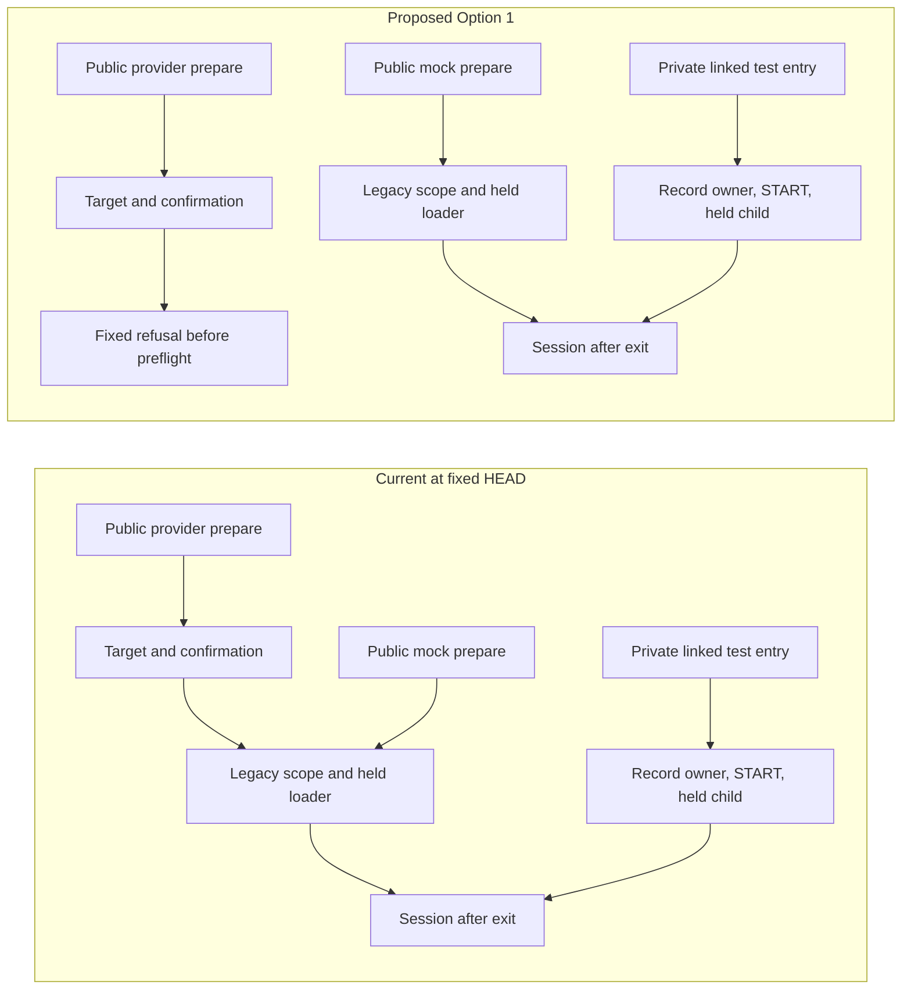

# Post-START-Linked Entry-Point Enforcement Plan

- **Status** DRAFT_NEXT_UNIT_CONTRACT_NOT_IMPLEMENTED_NOT_OPERATIONAL_APPROVAL
- **Design date** 2026-11-10 JST
- **Repository and branch** `Blue-jp/tridentine-calendar-ja-google-sync` · `security/deep-scan-remediation-47194b0`
- **Fixed HEAD** `b8856853555d3de5d1bc79176756468db5cbc6a8`
- **Fixed tree** `e216e64f87c5c8e24543ec4dcbc6287607594e22`
- **Sole parent** `e3c5f32295b594b7ed3692fc54060915ad22472d`

The linked mock entry holds one record-owned lock from START publication through session processing and finalization. Its direct caller in the reviewed tree is the dedicated acceptance test. The public provider-evidence prepare entry still delivers a credential-bearing session for a valid, unexpired pair without consulting START or operation history. I recommend closing that one public entry after target and confirmation validation. This removes its current delivery path while the project decides who can supply managed operation expectations. The explicit mock prepare path and its reentry characterization remain available for synthetic work. [Linked coordinator](../src/tridentine_calendar_google_sync/production_write_token.py#L1834-L1954), [test caller](../tests/test_token_start_linked_session_phase6d1h.py#L306-L325), [public prepare wrappers](../src/tridentine_calendar_google_sync/production_write_token.py#L1296-L1354)

## Evidence at the fixed revision

| Label | Evidence and scope |
| --- | --- |
| CURRENT_SOURCE | I inspected the named entry points, their immediate delegates, and tracked call sites at the fixed HEAD. The map describes source-visible calls, imports, aliases and wrappers. External consumers, dynamic dispatch beyond the reviewed branches, and arbitrary process mutation remain unverified. |
| CURRENT_TEST | The linked acceptance tests, legacy reload and reentry characterizations, writer and diagnostic tests, and consumer guards were read as definitions. Their references describe what they assert. |
| INHERITED_EVIDENCE | Local Windows/Python 3.12.14 recorded 648 collected, 579 passed, 69 skipped, zero failed, errors or deselected, and exit 0. Local Linux native three and eight full-file regression groups retain their unrun history. |
| INHERITED_EVIDENCE | PR #17 was verified Open, Draft and unmerged with auto-merge null and 38 commits. Run 42538959400, attempt 1, recorded eight successful jobs. Prior review covered detailed logs for both base and both google-production-write jobs and job/step metadata for the other four. The START-linked file recorded Ubuntu 104 passed and 1 skipped and Windows 102 passed and 3 skipped. Linux native three was mapped from file progress and fixed source. Individual node results and JUnit evidence were unavailable. Evidence comment `6740592646` was verified saved. |
| PROPOSED / OPEN | The next unit below is a design. Open decisions belong to the specific engineering, release or audit boundary they block. |

The [START-linked contract](production-write-token-start-linked-session-contract.md) is the fixed 69,886-byte document with SHA-256 `0f41fdececa0a12c603455b28830dbb0e0ef24db553ff41083e87f649bb9c8df` and raw blob `85e183e16b941181ff66ee5aec13799b802895a7`. Sections 1–8 describe the earlier baseline and design. Sections 9–11 record implementation, the actor boundary and the accepted-transition corrections. The historical status at the top belongs to the earlier design. The inherited CI and PR evidence predates this plan. [Implementation and preserved boundaries](production-write-token-start-linked-session-contract.md#L636-L681), [actor correction](production-write-token-start-linked-session-contract.md#L840-L878), [transition correction](production-write-token-start-linked-session-contract.md#L969-L1008)

## Current session and authorization paths

We have two ownership models around one held session body. The legacy wrapper creates its own scope. On Linux its lock helper takes one nonblocking advisory lock per distinct lexical parent, at most two, in sorted order. The scope and helper unwind entered contexts. Windows yields a no-op checkpoint and retains its existing storage path. The linked parent accepts only Linux, an existing pair in one lexical directory, distinct START/token/state leaves, the expected token/state roles and independently supplied REFRESH and predecessor references. Matching lexical layout does not attest physical aliasing or deployment provenance. [Legacy lock](../src/tridentine_calendar_google_sync/production_write_token.py#L137-L190), [legacy scope](../src/tridentine_calendar_google_sync/production_write_token.py#L893-L1005), [linked layout](../src/tridentine_calendar_google_sync/production_write_token_operation_record.py#L935-L990)

| CURRENT_SOURCE entry at fixed HEAD | Caller, gate and START | Owner and effect order | Inputs and CURRENT_TEST contract |
| --- | --- | --- | --- |
| [production_write_token.py · `_prepare_start_linked_session_mock`, 1834–1954](../src/tridentine_calendar_google_sync/production_write_token.py#L1834-L1954) | Test-only direct invocation. The factory checks target and exact confirmation, Linux, UTC, the path set and an explicit fake refresher. START creation and matched readback are required even for an unexpired token. | The shared parent enters the record owner once. Actual held create latches success. An admitted child runs the existing held session body, then the coordinator checks the candidate while held and finishes the parent. Delivery follows finalization and exit. | Fixture setup supplies paths, target, confirmation, binding, operation and predecessor. The factory binds one parent and exact child to separately retained expected values and actor identity. [Factory and association](../src/tridentine_calendar_google_sync/production_write_token.py#L1494-L1736), [normal and Windows controls](../tests/test_token_start_linked_session_phase6d1h.py#L389-L504), [actor and phase interruption cases](../tests/test_token_start_linked_session_phase6d1h.py#L1437-L1602), [handoff cases](../tests/test_token_start_linked_session_phase6d1h.py#L1755-L1810) |
| [production_write_token.py · `prepare_production_write_rehearsal_credential_session`, 1296–1323](../src/tridentine_calendar_google_sync/production_write_token.py#L1296-L1323) | Exported provider-evidence library entry. Direct test callers are visible. Target and exact confirmation precede the legacy loader. START, binding and operation history are absent from this entry. | The legacy scope handles path preflight, ownership, both reads and normal exit. A valid unexpired provider-evidenced pair can yield a session. The wrapper supplies `refresher=None`, so expiry reaches the existing unavailable-refresh refusal, with zero refresh and save. | The request supplies paths, target and time. Provider-origin evidence is checked on the loaded token. [Grant reload and wrong-origin controls](../tests/test_production_write_grant_provenance_phase6d1d.py#L256-L307), [provider and mock flow cases](../tests/test_token_session_owned_body_phase6d1h.py#L280-L368) |
| [production_write_token.py · `prepare_production_write_rehearsal_credential_session_mock`, 1326–1354](../src/tridentine_calendar_google_sync/production_write_token.py#L1326-L1354) | Exported explicit test-evidence library entry. Target and exact confirmation precede the same legacy loader. START and history are absent. | The legacy scope owns entry and exit. An unexpired token returns with refresh count zero. Expiry can invoke the supplied fake refresher once and persist one validated token after recheck. Delivery follows scope exit. | The request supplies paths, target, time and optional fake refresher. No binding, operation or predecessor is accepted. The independent memory reentry test observes the previously published token on a new invocation after an earlier failure. [Reentry characterization](../tests/test_token_session_failure_reentry_phase6d1h.py#L335-L429) |
| [production_write_token.py · `authorize_production_write_token`, 647–673](../src/tridentine_calendar_google_sync/production_write_token.py#L647-L673) | Exported live authorization entry. It discards the supplied arguments and raises the fixed hard-off error. | The refusal precedes client-material reads, provider calls, lock acquisition, writes and any result. START is outside this refusal path. | Caller parameters supply no admission authority. [Signature guard](../tests/test_production_write_grant_provenance_phase6d1d.py#L184-L193), [CLI refusal checks](../tests/test_cli_phase6d0.py#L153-L225) |
| [production_write_token.py · `authorize_production_write_token_mock`, 676–750](../src/tridentine_calendar_google_sync/production_write_token.py#L676-L750) | Explicit test authorizer. Target, confirmation, new-pair path checks and adapter flags precede reading client material. START, enrolled binding and independent operation history are absent. | Client configuration is loaded and the injected authorizer runs **before** bundle publication acquires Linux locks. Accounting, grant evidence and token/state binding precede the bundle save. The wrapper returns an authorization result after publication. | The request supplies paths, target, time and the mock authorizer. The initial generation is constructed locally and is distinct from an operation identity. [Mock evidence and origin controls](../tests/test_production_write_grant_provenance_phase6d1d.py#L143-L180), [mock evidence persists without provider origin](../tests/test_production_write_grant_provenance_phase6d1d.py#L239-L253) |
| [cli.py · authorization and read-only rehearsal, 1209–1261, 1703–1712, 2258–2261](../src/tridentine_calendar_google_sync/cli.py#L1703-L1712) | The parser and dispatch reach fixed fatal handlers for `authorize-production-write-token` and `rehearse-production-write-token-readonly`. There is no dispatch from these handlers to linked prepare, the legacy prepare functions or diagnostic factories. | The handlers write fixed errors and return a fatal code. There is no START, lock, credential read, provider call, save or session. | Parsed path/confirmation arguments are discarded. [Dispatch](../src/tridentine_calendar_google_sync/cli.py#L2258-L2261), [handler call guard](../tests/test_phase6d0_privacy.py#L32-L51), [fatal guard and redaction tests](../tests/test_cli_phase6d0.py#L153-L225) |
| [production_write_token_rehearsal.py · `run_production_write_token_readonly_rehearsal_mock`, 730–791](../src/tridentine_calendar_google_sync/production_write_token_rehearsal.py#L730-L791) | Synthetic orchestration calls an injected session provider after confirmation and fake-provider checks. The provided fake returns its stored session or raises its stored error. It does not invoke either public prepare function or linked prepare. | The wrapper validates the returned session, then builds the fake transport and executes the synthetic read path. This layer does not own a credential lock or save. Its START and binding inputs are absent. | Tests provide a session or failure and a fake transport. The adapter check uses `isinstance` and flags. It establishes the intended fixture boundary. [Fake session provider](../src/tridentine_calendar_google_sync/production_write_token_rehearsal_transport.py#L180-L208), [provider gate](../src/tridentine_calendar_google_sync/production_write_token_rehearsal_transport.py#L300-L324) |

The common held body admits a one-use owner before loading state and token. It verifies the pair and checkpoints before the unexpired return. For expired inputs it checks the adapter before the single fake refresh and validates the returned evidence and identity before rereading state and token. It compares their canonical renderings, checkpoints, and passes the original token as `expected_token` to one persistence call. A separate checkpoint precedes construction of the refreshed session. The old pair comparison and POSIX replacement checks bound observed changes. They supply no transactional pair snapshot. [Held loader and both returns](../src/tridentine_calendar_google_sync/production_write_token.py#L1129-L1266), [original-token writer check](../src/tridentine_calendar_google_sync/production_write_token_io.py#L349-L395)

On the linked path, the record scope acquires once, checks occupancy, publishes START create-only and reads it back. Child issuance requires the genuine held-create latch. Foreign actors are rejected before lifecycle mutation. The accepted entry and exit paths unwind interruptions without borrowing or reacquiring a lock. The consumed-phase checkpoint uses the original held handle. The writer adapter retains writer exception W for the existing handler to produce P, with separate START and credential publication evidence. The parent finalizer retains the first cancellation and ordinary primary and owns stack release. Normal return follows finalization. It establishes the observed exit path within the backend's reporting limits. [Held create and latch](../src/tridentine_calendar_google_sync/production_write_token_operation_record.py#L586-L650), [child admission and phase](../src/tridentine_calendar_google_sync/production_write_token_operation_record.py#L1077-L1344), [final checkpoint](../src/tridentine_calendar_google_sync/production_write_token_operation_record.py#L1347-L1406), [writer adapter](../src/tridentine_calendar_google_sync/production_write_token.py#L1780-L1831), [finalizer](../src/tridentine_calendar_google_sync/production_write_token_operation_record.py#L1489-L1608), [backend close behavior](../src/tridentine_calendar_google_sync/_posix_private_lock.py#L63-L99)

## Current writers and diagnostic paths

| CURRENT_SOURCE entry at fixed HEAD | Caller, gate and START | Owner and effect order | Inputs and CURRENT_TEST contract |
| --- | --- | --- | --- |
| [production_write_token_io.py · `write_production_write_token_bundle` and `_write_posix_token_bundle`, 530–686](../src/tridentine_calendar_google_sync/production_write_token_io.py#L530-L686) | Called by the explicit mock authorization entry and directly by tests. Public preflight validates the pair and distinct output paths. START and operation inputs are absent. | The POSIX wrapper takes the shared session locks and writes state, checkpoints, writes token, checkpoints, and exits before success. It preserves partial-publication evidence. The Windows path keeps the legacy state-first writes and exact-new-artifact failure cleanup without this lock protocol. Neither branch calls a provider or constructs a session. | The caller supplies token, state and output paths. [Lock and effect-order controls](../tests/test_token_bundle_lock_phase6d1h.py#L103-L262), [sole acquiring wrapper guard](../tests/test_token_bundle_lock_phase6d1h.py#L383-L403) |
| [production_write_token_io.py · `write_production_write_authorized_user_token`, 293–346](../src/tridentine_calendar_google_sync/production_write_token_io.py#L293-L346) | Exported lower writer. Called by bundle publication, Windows refresh persistence and direct tests. START and independent expectations are absent. | The leaf writer acquires no shared session lock. POSIX create-only uses the private-create adapter. Explicit overwrite and the Windows branch use the existing atomic writer. The call returns a path, with no provider or session. | The caller supplies token, output path and overwrite choice. A bundle caller may already own a lock. [Bundle compatibility and writer controls](../tests/test_token_bundle_lock_phase6d1h.py#L103-L262), [Windows and expected-byte persistence test](../tests/test_refresh_replace_integration_phase6d1h.py#L105-L165) |
| [production_write_token_io.py · `write_production_write_token_generation_state`, 478–505](../src/tridentine_calendar_google_sync/production_write_token_io.py#L478-L505) | Exported lower create-only state writer used by bundle publication and direct tests. START, operation and predecessor inputs are absent. | The leaf writer owns no shared session lock. POSIX uses the private-create adapter. Windows uses legacy atomic no-overwrite. It writes the supplied state and returns a path. | The caller supplies state and output path. The prior generation hash on state is credential metadata. [State-first order and partial publication](../tests/test_token_bundle_lock_phase6d1h.py#L103-L221) |
| [production_write_token_io.py · `persist_refreshed_production_write_token`, 349–395](../src/tridentine_calendar_google_sync/production_write_token_io.py#L349-L395) | Exported lower writer captured by both session factories. The linked adapter invokes it under record ownership, while the legacy loader invokes it under its own scope. The writer itself has no START check or ownership argument. | It acquires no shared session lock. POSIX passes expected original token bytes to the private replacement backend for target comparison. Windows calls generic overwrite. It saves token only and returns a path. It does not call a provider, write generation state or produce a session. | The caller supplies the validated new token, path and original `expected_token`. That value describes the replacement target bytes. [Prewrite check](../tests/test_refresh_prewrite_recheck_phase6d1h.py#L397-L515), [replacement call shape](../tests/test_refresh_replace_integration_phase6d1h.py#L367-L412) |
| [production_write_token_operation_record.py · `create_start_record` / `read_start_record`, 653–715](../src/tridentine_calendar_google_sync/production_write_token_operation_record.py#L653-L715) | Standalone synthetic record APIs. Each call owns a separate scope. Public START confirmations or observations follow that scope's exit. | Linux record owner acquires/releases one directory. Create publishes and reads back START. Read only matches the record. Neither path reads credentials, calls providers or returns a session. The standalone scope cannot issue a linked child. | The caller supplies binding and operation expectations. Occupancy can refuse create without inferring an authentic operation from stored bytes. [Exit order](../tests/test_token_operation_record_phase6d1h.py#L648-L697), [standalone read cannot issue linked child](../tests/test_token_start_linked_session_phase6d1h.py#L795-L824) |
| [production_write_token_pair_inspection.py · `inspect_production_write_token_pair`, 61–141](../src/tridentine_calendar_google_sync/production_write_token_pair_inspection.py#L61-L141) | Read-only diagnostic with no reviewed source consumer. UTC, target and path checks precede reading the pair. START and history are absent. | Uses the legacy session lock helper for pair reads and checkpoints. Windows retains its no-op checkpoint. It returns a nonauthorizing observation after exit. No provider, save or session delivery. | Caller paths, target and time describe the inspection. The result's fixed `reuse_authorized=False` is part of its type. [Diagnostic and consumer guard](../tests/test_token_pair_inspection_phase6d1h.py#L373-L409) |
| [production_write_token_reuse_policy.py · `evaluate_reuse_policy`, 316–395](../src/tridentine_calendar_google_sync/production_write_token_reuse_policy.py#L316-L395) | Pure synthetic refusal model with no reviewed runtime consumer. It checks supplied binding, operation, trace order and predecessor history. It reads no START file. | No lock, filesystem, provider or session. Recognized uncertainty and failure are retained before other validation. Even observed completion carries `reuse_authorized=False`. | The test or caller supplies all model history, registration and appearance observations. [Trace and predecessor checks](../src/tridentine_calendar_google_sync/production_write_token_reuse_policy.py#L210-L313), [purity and empty runtime consumer set](../tests/test_token_reuse_policy_phase6d1h.py#L735-L792) |
| [production_write_token_disabled_bootstrap_entry.py · `bind_synthetic_disabled_bootstrap` / `SyntheticDisabledBootstrapEntry.diagnose`, 190–281](../src/tridentine_calendar_google_sync/production_write_token_disabled_bootstrap_entry.py#L190-L281) | Test-only configured diagnosis. Setup captures a synthetic plan without reading sources. The ordinary request supplies only the pair reference. The bound entry rejects drift before one loader call. The chain checks disabled/PREPARING inputs and preparation observations. It has no START/session join. | The loader reads bounded policy and expected descriptor companion bytes and rechecks identity. The handoff can inspect preparation evidence. The entry provides no credential lock, credential reads, provider calls, writes or session. | Setup supplies independent expected control root, pair, slots, revision and pin. The result carries no permit. [Source loader](../src/tridentine_calendar_google_sync/production_write_token_disabled_bootstrap_source_loading.py#L333-L432), [handoff](../src/tridentine_calendar_google_sync/production_write_token_disabled_bootstrap_inspection.py#L254-L294), [closed entry and empty consumer set](../tests/test_token_disabled_bootstrap_entry_phase6d1h.py#L1970-L1991) |

The writer API graph is an important limit. The linked coordinator chooses an owner before it calls the lower refresh writer. Direct callers of that writer and the two standalone leaf writers receive no such admission requirement. The POSIX bundle joins the legacy lock protocol only at publication, after mock authorization can already have acted. Requiring the linked REFRESH scope around that bundle would reacquire its lock and would put START too late in the current authorization flow. NEW_PAIR would need its own ordered coordinator and publication contract. [Current bundle caller and lock](../src/tridentine_calendar_google_sync/production_write_token.py#L714-L749), [bundle ownership](../src/tridentine_calendar_google_sync/production_write_token_io.py#L530-L555), [historical operation ordering](production-write-token-operation-record-design.md#L96-L126)

The fixed guards give us exact static boundaries to preserve. The operation-record module has one reviewed runtime consumer, `production_write_token.py`, and its exact direct lock and publisher sets are checked separately. Diagnostic modules have their own closed graphs. Adding an application edge to pair inspection, pure policy or the configured disabled entry would require explicit review of the affected allowlist. The accepted-baseline registry belongs to source-baseline policy. Its active-pin gate fails closed when uninitialized, and credential enrollment remains a separate responsibility. [Record consumer checks](../tests/test_token_operation_record_phase6d1h.py#L392-L488), [lock consumers](../tests/test_posix_private_lock_phase6d1h.py#L411-L443), [directory and publisher consumers](../tests/test_posix_sensitive_directory_phase6d1h.py#L351-L410), [registry source gate](../src/tridentine_calendar_google_sync/accepted_production_baseline_registry.py#L285-L324), [registry test](../tests/test_accepted_production_baseline_phase6d1g.py#L126-L136)

## Obligations and ordering

| Boundary | CURRENT_SOURCE | PROPOSED / OPEN |
| --- | --- | --- |
| Binding and authority | The linked setup retains expected values independently of the START readback. A caller can still supply those synthetic values. | An owner-approved installation source would hold the managed roots, roles, binding, revision, pin and operation inputs outside ordinary requests. Source authenticity and update authority remain open. |
| Policy and enforcement | The pure model returns negative evidence and never authorizes. The legacy loader has no policy call. | A future caller must actually enforce the relevant refusal before credential use. The selected unit closes one caller while the positive admission contract remains open. |
| Diagnosis and credential authority | Pair and bootstrap diagnostics return observations with False authorization. The session model carries credentials and accounting. | Keep diagnostic observations separate from any future admitted request. A matching diagnostic, normal return or exit code cannot grant credential use. [Session model](../src/tridentine_calendar_google_sync/production_write_token_models.py#L175-L182) |
| Lock lifetime and restart | Linked ownership covers one call and an occupied slot can refuse the next create. In-memory exception and publication facts have the current call's lifetime. | Restart needs independently retained and verified launch inputs and complete durable evidence. Unknown history remains a refusal. |
| START presence and absence | Linked create refuses any occupied slot. A successful create/readback follows checked expectations within that owner. | START absence supplies no history approval. Missing or unverifiable expected operation inputs stop before managed effects. |
| Delivery and completion | A linked candidate may be delivered after successful finalization. The record remains started/incomplete after that call. | A future completion protocol needs authenticated operation/binding evidence, publication disposition and explicit handling of checkpoint or exit uncertainty. Candidate delivery alone supplies no record retirement proof. |
| Retention and reconciliation | The bounded record APIs create or read the fixed slot. No release or successful result clears it. | Retirement and recovery require a separate decision and a reviewed reconciliation protocol. Visible matching bytes, a clean return and CI success cannot supply that decision. |
| Participation and process trust | Exact object and actor checks constrain cooperating calls within the reviewed process. Advisory locks coordinate participating Linux writers. | All-caller claims require actual routing or refusal at each named boundary and a defined threat model for nonparticipating writers, aliases and same-authority replacement. Python private names supply no hostile-process containment. |

The existing reentry characterization is particularly useful here. Its first explicit mock call can leave a visible published token and raise a persistence error. A second legacy mock call can read that token and return with zero refresh or save, while a separately supplied pure-policy input rejects the unresolved failure. That is the scope of the characterization. The new linked test path does not change either legacy invocation. We can keep this regression as evidence of the remaining connection gap. [Reentry test definition](../tests/test_token_session_failure_reentry_phase6d1h.py#L335-L429), [historical gap review](production-write-token-enforcement-gap-review.md#L36-L63)

## Decision and alternatives

**Option 1 · Refuse the public provider-evidence prepare call.** The exported wrapper currently reaches a credential-bearing return even with a hard-off CLI and no refresh adapter. Closing the wrapper removes that path for valid unexpired and expired requests alike, on both platforms, without inventing an authority source. The cost is an intentional public behavior change for direct library consumers. We found direct callers in tests and no package caller in the reviewed tracked references. External callers remain unverified.

**Option 2 · Admit one managed synthetic mock caller through fixed setup.** A fixture owner would capture a detached binding, REFRESH operation and predecessor, ordered paths and one fake refresher before giving the ordinary caller an entry. The ordinary request could name the retained pair and request preparation, with no override of those values. This would be useful if we had a particular existing synthetic consumer to migrate, an approved setup/request boundary, and agreement on the fate of direct legacy calls. A second route that leaves those calls available does not remove the provider-evidence public return. This option is deferred.

| Tradeoff | Option 1 · Public refusal | Option 2 · Bound synthetic caller |
| --- | --- | --- |
| Security | Removes the named public delivery path. Private legacy helpers, explicit mock callers and standalone writers retain their current scope. | A selected caller could enforce START before its own effects. Coverage would depend on the approved caller list and refusal of fallback paths. |
| Performance and memory | Source-derived. The denied call keeps in-memory validation and creates one fixed error before path preflight, locks, reads or a candidate. No measured latency or memory claim. Validate with zero-effect counters. | Source-derived direction. A setup snapshot and one record acquisition/readback add bounded state and I/O for admitted calls. Measure lock attempts, reads, publication and peak fixture state before broadening scope. |
| Reliability and operations | Deterministic refusal on each call, with no new state to repair. Publish the compatibility change and fixed error code. Reopening requires a separately reviewed migration. | The retained START can make a second request unavailable even after normal exit. Setup replacement, process restart, contention and any return to a legacy route need explicit handling. |
| Migration and rollback | One wrapper changes. Synthetic tests preserve the lower provider-evidence and mock controls. Any rollback that restores public delivery is a review decision because it restores the same unprotected edge. | A chosen consumer and its tests would migrate. Reverting the consumer must preserve START and stop managed effects until the boundary is reviewed. No record cleanup belongs in rollback. |

I recommend Option 1 for the next unit. It moves a real, named public boundary with a small edit surface and a measurable refusal before effects. If the project requires continued provider-evidence session delivery from this public wrapper, the maintainer must decide whether to accept the temporary denial or specify a separately approved managed caller and input contract first. [Public wrapper](../src/tridentine_calendar_google_sync/production_write_token.py#L1296-L1323), [public-provider behavior in tests](../tests/test_token_session_owned_body_phase6d1h.py#L280-L368)



| Change | Before | After | Security consequence | Cost |
| --- | --- | --- | --- | --- |
| Public provider prepare | Can enter the legacy scope and deliver an unexpired credential-bearing session. | Valid target and confirmation reach a fixed refusal before credential preflight. | A direct call to this exported wrapper cannot issue a session without managed history admission. | Direct library consumers lose this return and receive the fixed error. |

## Proposed implementation contract for Option 1

Change `prepare_production_write_rehearsal_credential_session` in [production_write_token.py](../src/tridentine_calendar_google_sync/production_write_token.py#L1296-L1323). Retain its public name, export and call signature. The return annotation remains part of the public signature even though the proposed phase provides only refusal.

```python
def prepare_production_write_rehearsal_credential_session(
    production_write_token_path: str | Path,
    generation_state_path: str | Path,
    production_read_token_path: str | Path,
    test_write_token_path: str | Path,
    target: ProductionWriteTargetConfig,
    confirmation: str,
    *,
    now: datetime,
) -> ProductionWriteCredentialSession: ...
```

Keep the existing in-memory target validation and exact confirmation comparison in order. After they succeed, raise the existing `ProductionWriteTokenConfigError` type with code `production_write_token_provider_session_enforcement_unavailable` and the fixed message `Production write-token provider session preparation is unavailable`. This code is a proposal. The caller cannot supply a binding, Boolean, fake adapter, path, time or diagnostic result that enables the denied wrapper. There is no independently approved positive input in this unit. Existing target and confirmation refusals keep precedence. UTC, path, expiry and grant-origin checks inside the legacy scope are no longer reached through this wrapper. [Existing error class](../src/tridentine_calendar_google_sync/production_write_token.py#L67-L86), [pure target validation](../src/tridentine_calendar_google_sync/production_write_target.py#L108-L147), [exact confirmation](../src/tridentine_calendar_google_sync/production_write_token_rehearsal.py#L147-L165)

The refusal precedes path inspection, START, lock acquisition, credential reads, provider use, save and session construction. It needs no release or reacquisition because it creates no owner. The linked entry continues to use the record parent for the entire existing synthetic operation. The mock wrapper continues to use its legacy scope with its platform behavior. Do not move the refusal into the shared loader, where it would change test-evidence and private held behavior. Keep writer W/P precedence and the record finalizer intact. [Shared loader](../src/tridentine_calendar_google_sync/production_write_token.py#L1129-L1293), [mock wrapper](../src/tridentine_calendar_google_sync/production_write_token.py#L1326-L1354), [linked writer and coordinator](../src/tridentine_calendar_google_sync/production_write_token.py#L1780-L1954)

| Minimum proposed path | Change and reason |
| --- | --- |
| [src/tridentine_calendar_google_sync/production_write_token.py](../src/tridentine_calendar_google_sync/production_write_token.py#L1296-L1323) | Change only the named wrapper's behavior and docstring. Keep the signature and export. The legacy factory, lock helper, held body, refresh exceptions, mock wrapper, linked code and authorization definitions stay outside the edit. |
| [tests/test_token_session_owned_body_phase6d1h.py](../tests/test_token_session_owned_body_phase6d1h.py#L199-L395) | Separate the existing provider cases from public mock checkpoint assertions. Preserve provider unexpired construction, expired refusal and origin-mismatch controls through the existing private loader with fixture doubles. Add public fixed-refusal cases with no effects, and a narrow AST check for validation order, one fixed raise and absence of any path to the loader. Keep the two mock flow cases and legacy ownership, failure and cleanup tests. |
| [tests/test_production_write_grant_provenance_phase6d1d.py](../tests/test_production_write_grant_provenance_phase6d1d.py#L184-L307) | Keep the no-injected-adapter signature assertion and old-schema rejection. Move provider-evidence reload and wrong-origin discrimination to explicit legacy-loader controls on synthetic inputs. Assert the newly fixed public refusal separately. This avoids turning an unconditional gate into evidence that provider-origin checks still discriminate. |

The existing loader, prewrite, writer and persistence-handler AST contracts retain their exact scope. The proposed wrapper adds no consumer or backend import. Keep the record, lock, publisher and directory allowlists, the inspector, reuse-policy and bootstrap guards, and the CLI hard-off checks. The intentional test change is to the public provider behavior assertions identified above. No other guard should lose coverage to make the proposal pass. [Loader structure](../tests/test_credential_session_lock_phase6d1h.py#L483-L560), [persistence-handler guard](../tests/test_refresh_persistence_failure_phase6d1h.py#L313-L358), [prewrite guard](../tests/test_refresh_prewrite_recheck_phase6d1h.py#L397-L515), [replacement guard](../tests/test_refresh_replace_integration_phase6d1h.py#L367-L412), [record consumer checks](../tests/test_token_operation_record_phase6d1h.py#L392-L488)

| PROPOSED acceptance | Evidence to collect under separate implementation authorization |
| --- | --- |
| Memory on Windows and Linux | Call the real public wrapper with a valid in-memory target and exact confirmation. Cover fixture paths representing an unexpired pair, an expired pair and unsafe paths without opening any of them. Assert the same fixed code and no path conversion or preflight, START, lock, credential read, provider, save, candidate or cleanup. Use sentinels for these boundaries. |
| Validation and structure | Wrong target and wrong confirmation still produce their existing errors. Valid inputs always reach the fixed refusal. Verify the public signature and exact wrapper call shape. A private-loader test call does not count as public admission. |
| Legacy and linked memory regressions | Preserve provider-origin discrimination and the existing lower no-refresh contract. Keep explicit mock unexpired and one-refresh cases, the independent memory reentry characterization, and linked ownership, writer evidence, actor and phase interruption tests. |
| Native regression | The refusal introduces no filesystem or lock work. Re-run existing Linux linked competition and reacquisition tests and the applicable legacy/native regressions in an approved synthetic environment. Keep the actual Windows linked platform refusal. Local environment limits and CI evidence should be recorded independently. |
| New-process regression | Existing linked Linux tests probe independent child acquisition while held and after exit. The public refusal introduces no new process or durable state. Those linked probes remain regression evidence, with no inference about production restart or retirement. |

## Decisions that block later work

| OPEN decision and owner | Boundary it blocks |
| --- | --- |
| Maintainer approval for temporary refusal of a public library operation | Implementation of Option 1. If preserving direct provider delivery is a compatibility requirement, first approve a narrower managed admission contract with a named caller. |
| Deployment owner approval of an installation-fixed source, its provenance, and update/restart procedure | Real preparation, enrollment, startup integration and approval of managed roots, slots, revision, pin, administrative state and operation selection. Synthetic inputs exercise matching only. |
| Maintainer and deployment owner decision on participating writers, Linux/Windows support, alias identity, lock ordering, same-authority replacement and rollback scope | All-caller/write enforcement, mixed directory layouts, Windows parity and stronger operational claims. |
| Owner-approved completion, publication disposition, durable history and controlled reconciliation | Repeated managed operations, START retirement, recovery and reactivation. Token appearance, absence, routine exit and CI success cannot establish this evidence. |
| Original DS-04 artifact, evidence and formal closure criteria from the audit owner | Finding-specific assessment and formal close. The reviewed notes contain later summaries and report the original unavailable. They do not identify an original artifact available in the reviewed sources. |

The proposed narrow refusal can be implemented and checked with synthetic inputs once its compatibility change is approved. Real launch provenance, administration and restart are separate from that decision. The original DS-04 finding and authoritative close criteria remain unconfirmed. The gap review and historical operation design record that limitation. The later security notes summarize DS-04 work and remaining limits. [Gap review](production-write-token-enforcement-gap-review.md#L5-L11), [operation-record evidence limits](production-write-token-operation-record-design.md#L9-L17), [later security narrative](posix-private-artifact-security.md#L581-L590), [deployment authority](production-write-token-enrollment-bootstrap-contract.md#L30-L40), [restart and disposition](production-write-token-enrollment-bootstrap-contract.md#L126-L156)

| Control | Recorded state |
| --- | --- |
| DS-04 | PARTIAL |
| Historical Deep Security Scan | INCOMPLETE |
| Separate 47194b0 scan report | FAIL |
| Production gate | BLOCKED |
| Live handlers | hard-off |
| Packaged registry | empty / fail-closed |

## Authorized public-provider refusal: implementation and validation evidence

**Implementation date** 2026-11-10 JST. The user explicitly approved the temporary change to the public provider-evidence prepare function, including requests that formerly returned a session for an unexpired token. This resolves the compatibility decision recorded as open in the design above. The design text and its original status remain historical. The implementation keeps the public name, signature, return annotation and export. Its public behavior is intentionally incompatible with the former successful return.

The wrapper performs the existing target validation, then the existing exact confirmation validation. After both succeed it raises `ProductionWriteTokenConfigError` with code `production_write_token_provider_session_enforcement_unavailable` and public message `Production write-token provider session preparation is unavailable`. Invalid target and confirmation inputs retain their previous refusal and order. With both valid, the wrapper stops before UTC, path, expiry or grant-origin checks, and before any scope, owner or candidate exists. No automatic re-enable or fallback is part of this change. [Public wrapper](../src/tridentine_calendar_google_sync/production_write_token.py#L1296-L1317)

The exact source change is confined to this function's docstring and body. Its existing import and validation calls are preserved. Byte comparison covered all text outside the function, including the public export, explicit mock prepare, legacy scope and held loader, authorization definitions, linked coordinator, and W/P handling. Record, writer and backend files were outside the edit. The four existing lexical structure checks and the additional consumer and hard-off-related checks in the base selection passed. No consumer allowlist or existing structural guard was edited. [Base structure guard](../tests/test_credential_session_lock_phase6d1h.py#L483), [persistence-handler guard](../tests/test_refresh_persistence_failure_phase6d1h.py#L313), [prewrite guard](../tests/test_refresh_prewrite_recheck_phase6d1h.py#L397), [replacement guard](../tests/test_refresh_replace_integration_phase6d1h.py#L367)

| Earlier case | Current control and validation |
| --- | --- |
| Owned-body `test_public_paths_retain_real_construction_and_exact_checkpoint_order[test_unexpired]` and `[test_refreshed]` | Retained in the same test through the real public mock wrapper. Both passed with the existing checkpoint and effect expectations. |
| Owned-body `test_public_paths_retain_real_construction_and_exact_checkpoint_order[provider]` | Migrated to `test_private_provider_retains_real_construction_and_exact_checkpoint_order`. It uses the real private legacy loader with `evidence_mode="provider"` and `refresher=None`, and passed with the unexpired candidate returned after scope exit. |
| Owned-body `test_evidence_modes_and_provider_no_refresh_remain_closed[expired_provider]` and `[provider_test_evidence]` | Migrated to `test_private_provider_evidence_and_no_refresh_remain_closed` with the same parameter IDs. Both passed with the original refresh-unavailable and grant-origin mismatch codes, respectively. |
| Owned-body `test_evidence_modes_and_provider_no_refresh_remain_closed[test_provider_evidence]` | Migrated to `test_public_mock_rejects_provider_evidence`. The real public mock path still rejected provider origin. This passed. |
| Grant provenance `test_provider_evidence_token_reloads_but_old_or_missing_evidence_does_not` | Migrated to `test_private_legacy_provider_reload_and_old_schema_rejection`. It uses the real private legacy provider loader. The existing storage fixture, provider-origin assertions and old-schema rejection remain. This storage case was not run locally. |
| Grant provenance `test_test_evidence_token_cannot_enter_operational_reload_path` | Migrated to `test_private_legacy_provider_reload_rejects_test_evidence`. The existing storage fixture and grant-origin mismatch assertion remain. This storage case was not run locally. |

[Owned-body mock and private controls](../tests/test_token_session_owned_body_phase6d1h.py#L579-L716), [grant-provenance private controls](../tests/test_production_write_grant_provenance_phase6d1d.py#L260-L313)

The new owned-body tests run the real public wrapper. Seven fixed-refusal cases each call it twice, covering synthetic unexpired and expired provider fixtures, unsafe and absent path representations, naive and non-UTC times, and a path conversion sentinel. The wrapper does not read or classify those token fixtures. Four precedence cases call the wrapper with both validation inputs valid, each invalid separately and both invalid. Spies record only the wrapper's target and confirmation call sites and delegate to the real validators. The exact class, code, message and precedence assertions passed. A narrow AST test checks the unique public definition, signature, export, local import, call order and fixed raise. [New owned-body nodes](../tests/test_token_session_owned_body_phase6d1h.py#L377-L576)

The owned-body monitor names 35 patch targets for downstream time/path checks, legacy scope and loading, START and linked entry, lock acquisition, reads, authorization, refresh, writes, construction, cleanup, sockets and browser calls. Calibration exercised each blocker once and also exercised `__fspath__`, `__str__`, `__repr__` and `__format__` once each on the test-owned path sentinel. The blockers raised a test-owned BaseException without delegating. Both patch layers were restored. The 18 public calls in the fixed-refusal and precedence tests had zero monitored effects. The grant-provenance public test calibrated and restored six nondelegating probes for loader, scope, path set, reads and persistence, with zero monitored effects on its two public calls. These counts describe the named probes and their observation windows. Normal synthetic mock and private-loader regression cases performed their expected fixture effects. [Owned-body target list and calibration](../tests/test_token_session_owned_body_phase6d1h.py#L292-L414), [grant public refusal and calibration](../tests/test_production_write_grant_provenance_phase6d1d.py#L320-L390)

### Measured validation

Windows with the existing Python 3.12.14 resolved the package to this source tree. The Python constraint and 11 relevant installed dependency versions matched `uv.lock`, including the Google Production Write test dependencies. Existing strict markers, configuration and socket disabling were retained. Tests used Python `-B`, pytest `-q -vv -p no:cacheprovider`, and fresh test-owned scratch paths. The grant-provenance module retains its `google_production_write` marker and needed no additional opt-in for the selected nodes. [Test layer selection](../.github/workflows/test.yml#L23-L55), [grant marker](../tests/test_production_write_grant_provenance_phase6d1d.py#L64)

| Run | Collected | Passed | Failed | Errors | Skipped | Deselected | Exit |
| --- | ---: | ---: | ---: | ---: | ---: | ---: | ---: |
| Pre-edit provider positive control in owned-body | 1 | 1 | 0 | 0 | 0 | 0 | 0 |
| Final base selection in one process | 661 | 592 | 0 | 0 | 69 | 0 | 0 |
| Final google-production-write selection, four named nodes with parameters | 12 | 12 | 0 | 0 | 0 | 0 | 0 |

The pre-edit run confirmed the former public success with a synthetic unexpired provider token. No rejection-expectation RED was taken. During test authoring, changed-region Ruff checks in owned-body reported I001, B009 and E501. Those were corrected before the final suite.

The base run executed all six requested files with the new owned-body cases first, followed by the nine requested structural and consumer nodes. Owned-body contributed 123 passes, preserving the roles of 110 earlier cases and adding 13 cases. START-linked contributed 102 passes and three skips, record 331 passes and 56 skips, record-busy 21 passes, reentry three passes, and START/session three passes and 10 skips. All nine named nodes passed. The three Linux native START-linked cases were collected and skipped on Windows. Their native lock and independent child-process coverage remains locally unexecuted.

The separate google-production-write run selected the new memory-only public refusal and three pure or signature tests, with parameterization yielding 12 passing cases. It did not run the full file. The two migrated storage-based reload and origin cases remain locally unverified in the absence of an already approved guard-compliant private test area. The owned-body memory contrasts have their own passing evidence. Full local runs of the other storage regression groups and the Production token refresh file were outside the selected runs.

Final Ruff check and format check passed for the whole tree, with 289 files already formatted. Strict mypy passed for the changed source module and for all 124 source files. Git diff --check passed. The selected wrapper is the sole source definition changed, with the remaining file byte-identical to fixed HEAD. Comparison preserved all 43 unrelated original owned-body definitions and 12 unrelated original grant-provenance definitions. This document's original 40,511 bytes form an exact prefix.

### Remaining boundary

The fixed refusal applies to the exported provider prepare wrapper. Private legacy and explicit mock session calls and lower writers still have their prior behavior. The existing START-linked mock coordinator retains its dedicated coverage and own lifecycle. Enforcement across all callers and writers remains open. Reopening the public provider entry requires a separately reviewed change with its own admission contract. The registry stays empty/fail-closed. Trusted enrollment, completion, START retirement and recovery require separate decisions.

Run 42538959400, attempt 1, evidence comment `6740592646`, and the earlier local 648 collected, 579 passed and 69 skipped remain inherited history. They did not test this refusal change. The audit record remains DS-04 PARTIAL, Historical Deep Security Scan INCOMPLETE, separate 47194b0 scan FAIL, Production gate BLOCKED, live handlers hard-off, and registry empty / fail-closed.
